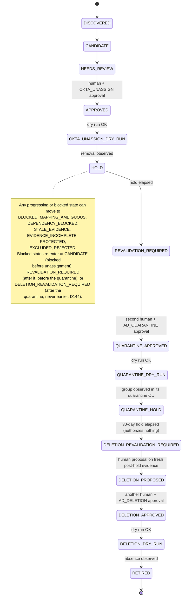

# Lifecycle state machine

Implemented in `app/domain/lifecycle.py`; the AD quarantine and deletion stages follow owner
decisions D128–D155 (migration 0011). Tested exhaustively in
`tests/test_lifecycle_state_machine.py` and `tests/test_lifecycle_ad_stages.py`, including a
check that this document lists every forward transition and every state.

Related: [domain-model.md](domain-model.md),
[../security/safety-invariants.md](../security/safety-invariants.md).

## Principles

1. **No arbitrary state assignment.** State changes only through `apply_transition()`,
   which looks the move up in the closed `TRANSITIONS` table. Anything not in the table is
   refused with `TransitionRefused`, whatever evidence is supplied.
2. **Progress requires proof; retreat requires only a reason.** Forward moves run a guard
   over the evidence, approval, and job. Moves to a safer state need only a non-empty
   reason, so a broken collector can never prevent a candidate from being stopped.
3. **A candidate is evidence for review, never authorization.** Every step toward change
   needs a valid, unexpired, fingerprint-matched approval from a named human.
4. **This build changes nothing.** Jobs can only be dry runs. `HOLD`, `QUARANTINE_HOLD`,
   and `RETIRED` are entered by *observing*, through read-only discovery, that an approved
   change has been made, never by OGWA making it.
5. **Every applied transition produces a `LifecycleDecision`** carrying the evidence
   fingerprint, and `apply_and_audit` writes refusals to the audit trail too.

## States

| State | Class | Meaning |
| --- | --- | --- |
| `DISCOVERED` | progressing (pre-unassign) | Created by `LifecycleCandidate.discover()`. Nothing has been checked yet |
| `CANDIDATE` | progressing (pre-unassign) | Fresh, complete evidence shows the assignments are present and unused |
| `NEEDS_REVIEW` | progressing (pre-unassign) | The case file includes an identity mapping and is ready for a human |
| `APPROVED` | progressing (pre-unassign) | A human approved removing the Okta assignments (`OKTA_UNASSIGN`) |
| `OKTA_UNASSIGN_DRY_RUN` | progressing (pre-unassign) | A dry run of the unassignment succeeded under that approval |
| `HOLD` | progressing (post-unassign, pre-quarantine) | Read-only discovery observed the assignments gone. Waiting `hold_period` |
| `REVALIDATION_REQUIRED` | progressing (post-unassign, pre-quarantine) | The hold has ended. Quarantining the AD group needs fresh evidence and a new approval |
| `QUARANTINE_APPROVED` | progressing (post-unassign, pre-quarantine) | A second human approved the AD quarantine (`AD_QUARANTINE`) |
| `QUARANTINE_DRY_RUN` | progressing (post-unassign, pre-quarantine) | A dry run of the quarantine succeeded under that approval |
| `QUARANTINE_HOLD` | progressing (post-quarantine) | Read-only discovery observed the group in its domain's quarantine OU. Waiting 30 days (D138) |
| `DELETION_REVALIDATION_REQUIRED` | progressing (post-quarantine) | The post-quarantine hold has ended, or a post-quarantine block was resolved. Fresh evidence is needed before anyone may propose deletion (D145, D155) |
| `DELETION_PROPOSED` | progressing (post-quarantine) | A human proposed deleting the quarantined group on fresh, complete post-hold evidence |
| `DELETION_APPROVED` | progressing (post-quarantine) | A different human approved the deletion (`AD_DELETION`, D143) |
| `DELETION_DRY_RUN` | progressing (post-quarantine) | A dry run of the deletion succeeded under that approval |
| `RETIREMENT_DRY_RUN` | progressing (legacy, pre-quarantine) | **Legacy (D148).** The dry run of the single AD stage that preceded quarantine and deletion. Kept so recorded history verifies; nothing new enters it, and from it only a diversion is possible |
| `RETIRED` | terminal | Read-only discovery observed that the AD group no longer exists |
| `EXCLUDED` | terminal | A human excluded the group from lifecycle management |
| `REJECTED` | terminal | A human decided not to proceed |
| `PROTECTED` | terminal | The group is protected (see [domain-model.md](domain-model.md#protection)) |
| `BLOCKED` | blocked (resumable) | Generic stop with a reason. Only a human can lift it |
| `MAPPING_AMBIGUOUS` | blocked (resumable) | The mapping is `AMBIGUOUS` or `NOT_FOUND` |
| `DEPENDENCY_BLOCKED` | blocked (resumable) | A blocking dependency was found |
| `STALE_EVIDENCE` | blocked (resumable) | Once-complete evidence has outlived its freshness window. Assigned by discovery or classification, never by an operator |
| `EVIDENCE_INCOMPLETE` | blocked (resumable) | Required evidence was never fully or properly obtained (a partial or failed result, or a record dated in the future). Assigned by discovery or classification, never by an operator. Since migration 0009 |

Terminal states have no outgoing transitions. If new evidence appears later, it creates a
new candidate.

## Forward transitions and preconditions

"Fresh for X" means every record named is `COMPLETE`, not future-dated, and younger
than the `X` freshness limit (REVIEW 30 days, APPROVAL 7 days, EXECUTION 24 hours by
default). Every forward guard also checks **consistency**: the evidence describes this
candidate's Okta group and assignments, the AD group is the mapped one, and dependency
evidence concerns the Okta group or the mapped AD group.

| Transition | Who | Preconditions |
| --- | --- | --- |
| `DISCOVERED` → `CANDIDATE` | system or human | Whole bundle fresh for REVIEW. Every candidate assignment `present`. For each affected app, a usage observation with window ≥ `min_usage_window` (90 days) and events ≤ `max_usage_events_for_candidate` (0). Not protected. No blocking dependency |
| `CANDIDATE` → `NEEDS_REVIEW` | system or human | All of the above, plus an identity mapping is recorded. **Any confidence**, including `NAME_ONLY`, `AMBIGUOUS`, and `NOT_FOUND`, because review is investigation |
| `NEEDS_REVIEW` → `APPROVED` | **human only**, and only the approving operator | All candidacy checks, fresh for APPROVAL. Mapping is **exact** (`EXACT_*`) and the mapped AD group exists. A valid `OKTA_UNASSIGN` approval: this candidate, current epoch, `APPROVE`, not by the proposer, within max lifetime, unexpired, and fingerprint equal to the current evidence |
| `APPROVED` → `OKTA_UNASSIGN_DRY_RUN` | system or human | All candidacy checks, fresh for EXECUTION. Exact mapping. The approval is still valid against the current fingerprint. An `OKTA_UNASSIGN` job that is a dry run, `SUCCEEDED`, not executed, for this candidate, planned under that approval after it was given, with the current fingerprint, and targeting exactly the candidate's assignments |
| `OKTA_UNASSIGN_DRY_RUN` → `HOLD` | system or human | Every candidate assignment is observed **absent**, fresh for EXECUTION, and observed after the dry run finished. The dry-run job and its approval are supplied, and the approval was still unexpired when the removal was first observed. (The fingerprint is not compared, because the approved change itself altered the evidence.) Sets `hold_until = now + hold_period` |
| `HOLD` → `REVALIDATION_REQUIRED` | system or human | `now ≥ hold_until` |
| `REVALIDATION_REQUIRED` → `QUARANTINE_APPROVED` | **human only**, and only the approving operator | The **AD-stage evidence rules** (below), fresh for APPROVAL, with the group **outside** its quarantine OU. A valid `AD_QUARANTINE` approval matching the current fingerprint, given at or after `hold_until`, by someone other than the Okta-stage approver (D11) and the candidate's proposer. Records `quarantine_approver` |
| `QUARANTINE_APPROVED` → `QUARANTINE_DRY_RUN` | system or human | The AD-stage evidence rules, fresh for EXECUTION, the group outside its quarantine OU. The approval still valid against the current fingerprint. An `AD_QUARANTINE` dry-run job (dry run, `SUCCEEDED`, not executed, planned under that approval after it was given, with the current fingerprint), targeting exactly the mapped AD group |
| `QUARANTINE_DRY_RUN` → `QUARANTINE_HOLD` | system or human | Exact mapping. The mapped AD group is observed to **exist as a direct child of its domain's quarantine OU** (D136), fresh for EXECUTION, observed after the dry run finished. The `AD_QUARANTINE` job and approval are supplied, and the approval was unexpired when the quarantine was observed. Sets `quarantine_hold_until = now + 30 days`: the hold runs from the confirmed observation (D138) |
| `QUARANTINE_HOLD` → `DELETION_REVALIDATION_REQUIRED` | system or human | `now ≥ quarantine_hold_until`. Nothing else: the end of the hold only opens revalidation and authorizes nothing (D139) |
| `DELETION_REVALIDATION_REQUIRED` → `DELETION_PROPOSED` | **human only** (the proposer) | The hold has ended. The AD-stage evidence rules, fresh for APPROVAL, with the group **inside** its quarantine OU, and **every record collected after the hold ended** (D130, D145). Records `deletion_proposer` and `deletion_proposed_at` |
| `DELETION_PROPOSED` → `DELETION_APPROVED` | **human only**, and only the approving operator | The same evidence rules as the proposal. A valid `AD_DELETION` approval matching the current fingerprint, given after the hold ended **and after the proposal**, by someone who is not the deletion's proposer, the quarantine approver, the Okta-stage approver (D143), or the candidate's proposer. No other stage's approval counts (D146) |
| `DELETION_APPROVED` → `DELETION_DRY_RUN` | system or human | The deletion evidence rules, fresh for EXECUTION. The approval still valid against the current fingerprint. An `AD_DELETION` dry-run job meeting the dry-run conditions above, targeting exactly the mapped AD group |
| `DELETION_DRY_RUN` → `RETIRED` | system or human | Exact mapping. The mapped AD group is observed **not to exist** (lookup by objectGUID), fresh for EXECUTION, and observed after the dry run finished. The `AD_DELETION` job and approval are supplied, and the approval was unexpired at the time of that observation |

Every request must also carry a non-empty reason and must not be dated before the
candidate's last change.

**The AD-stage evidence rules** hold for each AD stage's approval, proposal, and dry-run
steps (the observed steps check the observation instead): the evidence is consistent and the group AD-sourced (D12); the
candidate's assignments are still absent (re-adding one during a hold blocks); the mapping
is exact and the AD group exists; it is not protected; **dependency coverage is
`COMPLETE`** with no blocking finding (D131); the group's direct member count is known and
zero (D132); and the deployment's quarantine OU configuration (D136) shows the group where
the step needs it. With no quarantine OU configured for the group's domain, no AD-stage
step can pass.

## The AD stages

Owner decisions D128–D155. The AD side has two governed stages, each with its own approval
(`AD_QUARANTINE`, then `AD_DELETION`, D147):

- **Quarantine.** Approved in `REVALIDATION_REQUIRED` after the Okta hold by a second
  human (D11), dry-run, then observed: discovery sees the group in its domain's quarantine
  OU. The quarantine OUs are deployment-controlled configuration
  (`config/quarantine-ous.*.json`), separate from the candidate policy, and no operator can
  change them (D136).
- **Post-quarantine hold.** 30 days from the confirmed observation (D138), a constant in the
  code, not a policy value. Its end only opens revalidation (D139).
- **Deletion.** Revalidated on evidence collected after the hold, proposed by one human,
  approved by another who is not the proposer, the quarantine approver, or the Okta-stage
  approver (D143), dry-run, then observed. The approval must come after the proposal, so
  no earlier approval can be reused (D146).

**A quarantined candidate never goes back (D144).** Once `quarantine_hold_until` is set it
is never cleared. A candidate blocked from a post-quarantine state re-enters only at
`DELETION_REVALIDATION_REQUIRED` (D145, D155): after the hold has ended, on fresh evidence
collected after it, with the group still in its quarantine OU. Re-entry starts a new epoch
and clears the proposal, so a new proposal and a new approval are needed. The re-entry
guards, `verify_history`, the record invariants, and a CHECK on the `candidates` table
(migration 0011) each refuse a quarantined candidate in a pre-quarantine state.

**There is no unquarantine or restore operation (D149).** A group observed outside its
quarantine OU after the quarantine blocks the deletion stage; the candidate can be held,
excluded, or rejected, and anything else happens outside OGWA.

### The legacy single AD stage (D148)

Before the quarantine and deletion stages there was one AD stage: an `AD_RETIREMENT`
approval in `REVALIDATION_REQUIRED`, then `REVALIDATION_REQUIRED` → `RETIREMENT_DRY_RUN` → `RETIRED`. Those two transitions stay in
the table with category `legacy`, so recorded history still verifies, but their guard
always refuses, `allowed_targets()` does not offer them, and the API answers
`LEGACY_AD_RETIREMENT`. Stored `AD_RETIREMENT` approvals and jobs are kept verbatim and
authorize nothing; recording a new one is refused by the API, the store, and database
triggers. A legacy candidate in `RETIREMENT_DRY_RUN` can only be diverted, and re-enters at
`REVALIDATION_REQUIRED`, before any quarantine.

## Diversions (to a safer state)

From **every progressing state and every blocked state** to each of:

| Target | Who | Precondition |
| --- | --- | --- |
| `BLOCKED`, `MAPPING_AMBIGUOUS`, `DEPENDENCY_BLOCKED` | system or human | A reason |
| `STALE_EVIDENCE`, `EVIDENCE_INCOMPLETE` | **system only** | A reason. These record what the evidence says; an operator who wants to stop a candidate holds it (`BLOCKED`) |
| `PROTECTED` | system or human | A reason |
| `EXCLUDED`, `REJECTED` | **human only** | A reason |

On entering a blocked state, `blocked_from` records the progressing state the candidate
left. Moving between blocked states keeps the original value.

`recommend_diversion()` suggests a diversion from the evidence, in priority order
`PROTECTED` > `MAPPING_AMBIGUOUS` > `DEPENDENCY_BLOCKED` > `STALE_EVIDENCE` >
`EVIDENCE_INCOMPLETE` (the classifier's precedence). A record that is not decision-grade or
is dated in the future counts as incomplete; a complete record that is too old counts as
stale. It never applies a diversion itself.

Rejecting a candidate after `HOLD` does not restore the Okta assignment, and rejecting
one after its quarantine does not move the group back (D149). Either is a separate,
human-run change outside OGWA.

## Re-entry (from a blocked state)

| From | To | Who | Preconditions |
| --- | --- | --- | --- |
| any blocked state with `blocked_from` before unassignment | `CANDIDATE` | system or human (human only from `BLOCKED`) | The blocking condition has cleared, plus every `DISCOVERED` → `CANDIDATE` precondition |
| any blocked state with `blocked_from` after unassignment and before the quarantine | `REVALIDATION_REQUIRED` | system or human (human only from `BLOCKED`) | The blocking condition has cleared. Hold ended. Bundle fresh for REVIEW. Assignments still absent. Not protected. Clears `quarantine_approver` |
| any blocked state with `blocked_from` after the quarantine | `DELETION_REVALIDATION_REQUIRED` | system or human (human only from `BLOCKED`) | The blocking condition has cleared. Post-quarantine hold ended. Bundle fresh for REVIEW and **every record collected after the hold ended**. Assignments still absent. Exact mapping; the group exists, in its quarantine OU. Not protected. Clears the deletion proposal (D145). Never `CANDIDATE` or `REVALIDATION_REQUIRED` (D144) |

What "cleared" means: for `MAPPING_AMBIGUOUS`, the mapping is no longer `AMBIGUOUS` or
`NOT_FOUND`; for `DEPENDENCY_BLOCKED`, no blocking findings remain; for
`STALE_EVIDENCE` and `EVIDENCE_INCOMPLETE`, the freshness and decision-grade checks pass; for
`BLOCKED`, a human lifts it.

**Every re-entry increments `epoch`.** Approvals record the epoch they were given in, so
every approval from before the block becomes invalid and a new one is required.

## Who can act

| Action | `SYSTEM` | `HUMAN` |
| --- | --- | --- |
| Forward moves except approval | yes | yes |
| `NEEDS_REVIEW` → `APPROVED`, `REVALIDATION_REQUIRED` → `QUARANTINE_APPROVED`, `DELETION_PROPOSED` → `DELETION_APPROVED` | no | the approving operator only |
| `DELETION_REVALIDATION_REQUIRED` → `DELETION_PROPOSED` | no | yes (the proposer, recorded) |
| Give an `ApprovalRecord` | no | yes, except the candidate's proposer and, per stage, the people D11 and D143 exclude |
| Divert to blocked or `PROTECTED` | yes | yes |
| Divert to `EXCLUDED` or `REJECTED` | no | yes |
| Lift a generic `BLOCKED` | no | yes |

## History integrity

`verify_history(candidate, decisions)` replays the decision records from `DISCOVERED`.
It checks that each move is in the table and was made by an allowed actor kind, that
times never go backwards, that the epoch increments exactly on re-entry, and that the
replay ends at the candidate's stored state and epoch. It also reconstructs the
quarantine approver, the post-quarantine hold, and the deletion proposal from the decisions
and compares them with the stored candidate, and it refuses a history in which the
quarantine was approved by the Okta-stage approver (D11), the deletion was approved by a
person D143 excludes, or a quarantined candidate returned before its quarantine (D144). The store must run it when
loading a candidate, so a state written directly to the database is detected.

## What this build can and cannot reach

With synthetic data, the whole path to `RETIRED` can be exercised: at the domain level,
through the store, and through the operator API in `LOCAL_SYNTHETIC` (D152). Every job is a
dry run, and the unassignment, the quarantine, and the deletion are *observed* (synthetic
observations in tests and in the demo world, whose S15 and S16 stand in the quarantine hold
and with a proposed deletion). This build includes no live integration and never changes a
real system: `ExecutionJob` refuses `PRODUCTION_MUTATION` and any non-synthetic execution. In
the design, someone outside OGWA makes the change under a recorded approval, and OGWA then
observes it read-only. Enabling OGWA to perform these changes itself would require the steps
in [../security/execution-modes.md](../security/execution-modes.md), which this build does
not take.
