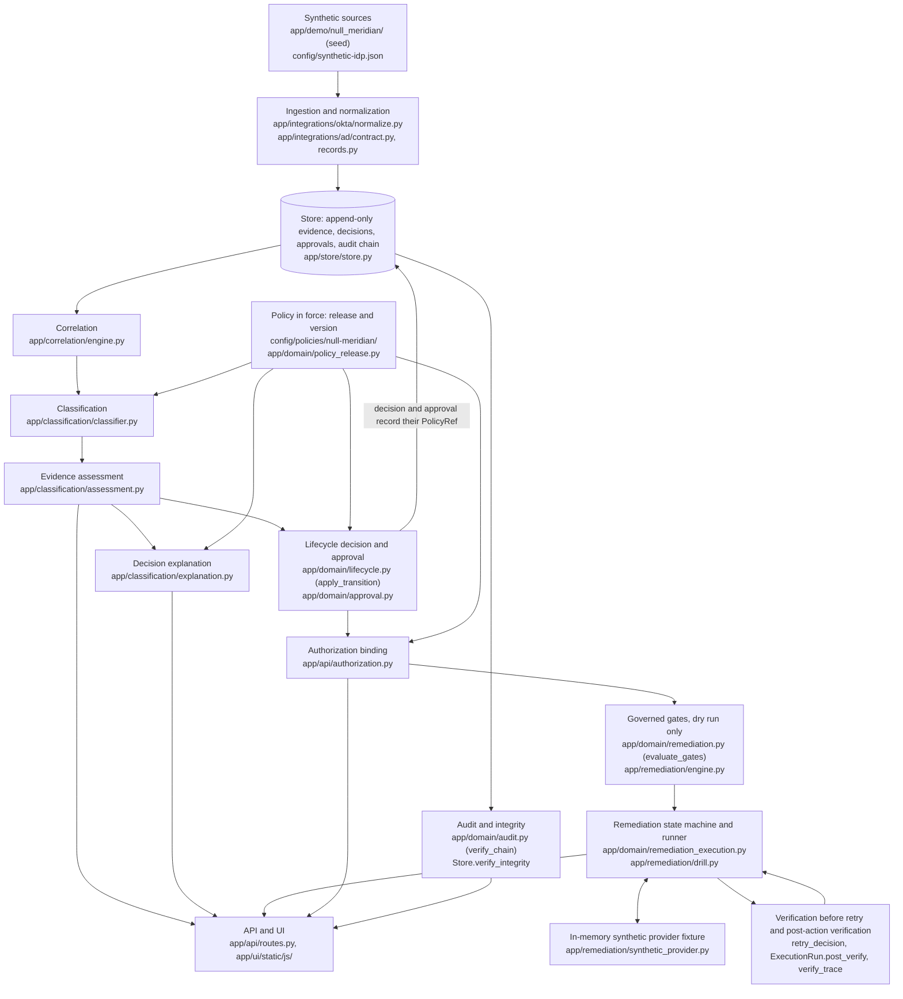

# Architecture overview

This page starts with the path from evidence to verified action in the demo. After that
come the build's status, its target shape and principles, and its modules by component.

## From evidence to verified action



| Stage | What happens here |
| --- | --- |
| **Evidence quality** (`assessment.py`) | Each source becomes one evidence item. Its state is one of `CONFIRMED`, `REPORTS_NONE`, `NOT_COLLECTED`, `SOURCE_UNAVAILABLE`, `PARTIAL`, `NOT_COUNTED_SOURCE`, `AMBIGUOUS` or `CONFLICTING`. These states never merge, and a conflict is shown, never resolved. The assessment's decision is the most restrictive constraint that applies. See [evidence-assessment.md](evidence-assessment.md). |
| **Policy versions** (`policy_release.py`, `Store._check_policy_ref`) | Every transition, approval and refusal records the exact `PolicyRef` that judged it, inside the same write. The store refuses a reference to a superseded version, and history is read back as it was recorded. See [../demo/policies/NM-LIFECYCLE-004.md](../demo/policies/NM-LIFECYCLE-004.md). |
| **Authorization** (`authorization.py`) | A dry run or a drill rests only on an approval, and on the decision that applied it, both judged by the version in force. Otherwise the answer is `409 APPROVAL_POLICY_NOT_IN_FORCE`. This check runs before any fixture exists and again before a retry. |
| **Synthetic execution** (`synthetic_provider.py`) | The fixture is an in-memory copy of one candidate's `SYNTHETIC` evidence. It is built for one request and discarded after the answer. It holds no store, client or connection. The governed path still never executes (D8, D153). |
| **Verification** (`remediation_execution.py`, `drill.py`) | An unknown outcome leads only to a read. A retry needs a read showing the before-state. Success (`POST_ACTION_VERIFIED`) needs a post-action read of the after-state with nothing else in scope changed. See [remediation-execution.md](remediation-execution.md). |
| **Audit** (`audit.py`, `store.py`) | Events form a SHA-256 hash chain. `verify_integrity` re-checks the migrations, the chain, the evidence digests, the candidate histories and the policy versions. A drill adds no event, so the audit head is unchanged. |
| **Hosted demo** (`app/cloudflare/hosted.py`, `cloudflare/worker/src/entry.py`) | The same WSGI application runs in a Cloudflare Python Worker, over a read-only copy of the validated store. Every request checks the D1 identity. See [../deployment/cloudflare-demo.md](../deployment/cloudflare-demo.md). |

The invariants for each stage, and the tests that enforce them, are in
[../security/safety-invariants.md](../security/safety-invariants.md): EA-*, PV-*, RX-* and DI-*.

## Build status

This build is a demo over synthetic data. The runtime mode is always `demo` and the
execution mode always `LOCAL_SYNTHETIC`; startup refuses anything else, including the keys
of live integrations and the credential variables of other tooling (see
[../demo-mode.md](../demo-mode.md) and
[../security/execution-modes.md](../security/execution-modes.md)).

It contains the persistent store; the domain model and lifecycle; Okta record normalization
and the AD report contract, fed by synthetic data only; the Okta-to-AD correlation engine;
candidate classification and the dependency policy; and the operator API and UI, with
synthetic sign-in only. The remediation path is **dry run only**: the AAP adapter validates
a launch but can never send one, and the PowerShell remediation worker runs only against its
in-memory synthetic adapter. The lifecycle models the AD quarantine, post-quarantine hold,
revalidation, and deletion stages, also with dry runs only.

The live Okta client, AAP discovery, the outbound HTTP transport, and the PowerShell AD
reader are not included in this build.

## Target shape

```text
Browser
  ↓            (no privileged credentials in the browser)
OGWA web/API service
  ├─ persistent lifecycle/audit store
  ├─ Okta API client      (read-only discovery by default; supported APIs, no UI scraping)
  └─ AAP adapter
         ↓
      PowerShell worker/module
         ↓
    Active Directory
```

In this build the Okta and AD sides are synthetic: there is no Okta API client and no AAP
discovery, and the AAP adapter and the PowerShell remediation worker plan only.

## Principles

1. Discovery and mutation use separate code paths, separate modules, and separate
   credentials.
2. A lifecycle candidate is evidence for review, never authorization to delete.
3. Matching an Okta group to an AD group by name alone is never enough for automatic
   retirement. Correlation needs a stable identifier (for example objectGUID or SID
   carried through Okta's AD integration), and ambiguity fails closed.
4. Mutation is feature-gated off. See [../security/execution-modes.md](../security/execution-modes.md).
5. AD access is isolated behind the AAP → PowerShell boundary. OGWA never holds AD
   credentials.

## Core and safety

| Module | Responsibility |
| --- | --- |
| `app/core/build.py` | Build-time safety constants (`BUILD_ALLOWS_PRODUCTION_MUTATION = False`) |
| `app/core/modes.py` | `ExecutionMode`, parsing, build-policy check |
| `app/core/runtime_mode.py` | The runtime mode: `demo` only |
| `app/core/config.py` | Strict environment loader: demo mode and `LOCAL_SYNTHETIC` only; refuses live-integration keys, unknown `OGWA_*` keys, and credential variables; diagnostics that never expose secrets |
| `app/core/secret.py`, `redaction.py`, `logging_setup.py` | Secret wrapper, text scrubbing, JSON-lines logging with redaction |
| `app/core/safety.py` | `MutationPolicy`, `MutationCapableService` |
| `app/core/startup.py`, `app/__main__.py` | Startup validation and banner |

## Domain model

`app/domain/` holds the pure domain model and lifecycle contract. It does no I/O and has
no network or clock access, and it cannot import HTTP or mutation code (`DomainPurityTests`).
See [domain-model.md](domain-model.md), [lifecycle-state-machine.md](lifecycle-state-machine.md),
and [../security/safety-invariants.md](../security/safety-invariants.md).

| Module | Responsibility |
| --- | --- |
| `app/domain/ids.py` | Internal IDs (`<prefix>_<32 hex>`) and shared field validation |
| `app/domain/evidence.py` | `Provenance`, material digests, `FreshnessPolicy` |
| `app/domain/model.py` | Okta/AD observations, `IdentityMapping` and confidence, dependency evidence and coverage |
| `app/domain/approval.py` | `ApprovalRecord` and its validity rules |
| `app/domain/execution.py` | `ExecutionJob` (dry run or synthetic only in this build) |
| `app/domain/audit.py` | Hash-chained, redacted `AuditTrail` |
| `app/domain/policy.py` | `LifecyclePolicy`, `EvidenceBundle`, evidence fingerprint, protection rules |
| `app/domain/lifecycle.py` | States, closed transition table, guards, `apply_transition`, `verify_history` |

## Store and demo data

`app/store/` is the persistent lifecycle and audit store, `app/demo/` holds the synthetic
datasets, and `app/runtime/` wires them into the demo. See [persistence.md](persistence.md)
and [../demo-mode.md](../demo-mode.md).

| Module | Responsibility |
| --- | --- |
| `app/core/database_url.py` | `OGWA_DATABASE_URL` parsing (SQLite only; PostgreSQL fails closed) |
| `app/domain/collection.py` | `CollectorRun`, `CollectorRunOutcome` (timeouts, rate limits) |
| `app/store/migrations/`, `migrator.py` | Versioned, checksummed, forward-only migrations |
| `app/store/store.py` | `Store`: evidence history, candidates and decisions, approvals, jobs, collector runs, audit chain, integrity verification |
| `app/store/environment.py` | Environment marker (SYNTHETIC / DEVELOPMENT / PRODUCTION) and what it permits |
| `app/store/reset.py`, `__main__.py` | Guarded reset; `python -m app.store status \| verify` |
| `app/demo/null_meridian/`, `datasets.py` | The default Null Meridian dataset and its seed; the dataset registry (`OGWA_DEMO_DATASET`) |
| `app/demo/synthetic_world.py` | The classic deterministic 16-scenario synthetic world |
| `app/runtime/` | The demo runtime: the synthetic provider boundary (`providers.py`), the demo store, and `python -m app.runtime status \| reset-demo \| verify` |

## Technology decisions

- **Python standard library only.** `unittest` replaces pytest. Nothing has to be
  installed, and the guardrails do not depend on any framework.
- **Dependencies (D4, D5).** Any dependency would go only into a project-local `.venv`,
  installed from an approved package source, never globally. See [decisions.md](decisions.md).
- **Web framework: none.** The operator API is a plain standard-library WSGI callable (see
  [Operator API](#operator-api)), served locally by `wsgiref` and in the hosted demo by a
  Cloudflare Python Worker. The guardrails are framework-neutral, and `bootstrap()` is the
  hook an app factory should call.
- **Persistence.** Standard-library `sqlite3` with PostgreSQL-compatible DDL and a
  hand-written migration runner. SQLAlchemy and Alembic were preferred, but no approved
  package source is configured (D5). The owner chose this on 2026-10-04; see
  [persistence.md](persistence.md). Local database files stay git-ignored.

## Design rules for directory-changing code

| Rule | Why |
| --- | --- |
| Dry run by default; real changes only behind an explicit switch, with `ConfirmImpact = 'High'`, a built-in protected-group list, and per-target structured results | A change must be deliberate, reviewable, and attributable |
| Resolvers return structured success or error objects instead of throwing | Batch evidence collection must keep going and record each failure |
| Forest-aware reads: each domain is queried against its own domain controller, and `ProtectedFromAccidentalDeletion` is recorded | A forest-wide name search can hit the wrong domain's object |
| Never search the forest by name and then delete without confirmation | Groups are resolved by stable identifier, multi-domain name matches are ambiguous and blocking, and nothing is deleted without a recorded approval |
| Never pass a token as a plain command-line parameter | Command lines are logged and visible to other processes |

## Okta records

`app/integrations/okta/` holds the Okta record models (`models.py`) and their normalization
(`normalize.py`): raw JSON to normalized records, failing closed per record, including the
objectGUID decoding that correlation uses (unverified, D30). Okta-shaped records come only
from the synthetic datasets. The read-only Okta client, its request pacing, System Log usage
collection, and evidence conversion are not included in this build. See
[okta-integration.md](okta-integration.md).

## AD report contract

The AD boundary is a strict report contract, fed by synthetic reports only. The PowerShell
AD reader is not included in this build; the golden fixtures in `tests/fixtures/ad/` are
synthetic reports in the contract's form. See [ad-integration.md](ad-integration.md).

| Module | Responsibility |
| --- | --- |
| `app/integrations/ad/contract.py` | Strict request and report contract (`ogwa.ad.group-read-request/v1`, `ogwa.ad.group-report/v1`) |
| `app/integrations/ad/assessment.py` | Three explicit emptiness facts (`ogwa-ad-empty/v1`); protection policy and assessment (UNDETERMINED blocks retirement) |
| `app/integrations/ad/records.py` | Conversion to `ADGroup` and AD `DependencyEvidence`; collector-run results |

## Identity correlation

Okta-to-AD identity correlation. See [identity-correlation.md](identity-correlation.md).

| Module | Responsibility |
| --- | --- |
| `app/correlation/engine.py` | `correlate()`: configured, directory-source, and approved-review claims resolved by stable id and cross-checked; name fallback only without claims (`NAME_ONLY`); drift detection |
| `app/correlation/directory.py` | Identity-lookup port; adapter over the AD report contract (identity-only requests), synthetic reports only (D22); per-correlation lookup cap |
| `app/correlation/evidence.py` | One `IdentityMapping` per Okta group per run |
| `app/correlation/review.py` | Service contract: inspect, bounded search, select, approve (exact or second-operator), reject |
| `app/domain/mapping_review.py`, migration 0003 | Append-only mapping-review registry |

## Classification and candidate policy

Candidate classification and dependency policy. See [candidate-policy.md](candidate-policy.md)
and [../operations/dependency-coverage.md](../operations/dependency-coverage.md).

| Module | Responsibility |
| --- | --- |
| `app/classification/classifier.py` | `classify()`: reason codes from every signal, then precedence, review tier, or (only with every proof) `RETIREMENT_CANDIDATE` |
| `app/classification/reasons.py` | Classifications, reason codes, and the fixed effect of each code |
| `app/classification/coverage.py` | Per-kind dependency coverage; which kinds have a production collector (none live-verified) |
| `app/domain/candidate_policy.py`, migration 0004 | Configurable thresholds, the strict policy document, and the append-only, four-eyes `policy_versions` registry |
| `app/domain/model.py` (`FindingCode`), migration 0004 | Coded dependency findings, so the D20 membership facts stay separate once stored |
| migration 0005, `config/candidate-policy.template.json` | Dedicated review audit actions (D41), policy reviewer roles (D33), the v1 policy template (D32, D35) |
| migration 0006 | `UNVERIFIED_STABLE_ID` mapping confidence for an unverified directory-source SID (D56) |

## Operator API

The operator API. See [api.md](api.md) and [../security/authorization.md](../security/authorization.md).
Standard library only: a plain WSGI callable, so any reviewed WSGI server can host it.

| Module | Responsibility |
| --- | --- |
| `app/api/app.py`, `routes.py` | WSGI application and route table: request ids, session authentication, Origin/CSRF checks, per-route permissions, structured errors |
| `app/api/services.py` | Transitions, approvals, dry-run planning, mapping reviews: separation of duties and lifecycle-guard prechecks |
| `app/api/authz.py`, `identity.py`, `sessions.py` | Roles and permissions, IdP-group-id role bindings, the identity adapter boundary (synthetic adapter only), sessions |
| `app/api/readmodel.py` | Bounded read-only queries and serializers |
| `app/api/local.py`, `__main__.py` | `python -m app.api serve`: always the demo, in `LOCAL_SYNTHETIC` over a SYNTHETIC store; binds 127.0.0.1 by default (`--host 0.0.0.0` for a container) |
| `app/store/store.py` (`audit_events_page`, `record_governed_refusal`), migration 0007 | Bounded, digest-verified audit reads; the `GOVERNED_REQUEST_REFUSED` audit action (D65) |
| Migration 0008, `OktaGroup.directory_object_sid_unverified` | Okta's directory objectSid, persisted as unverified source metadata (D84–D87) |
| `app/demo/synthetic_directory.py` | Synthetic AD identity directory over the store's own AD evidence, and the mapping-review gateway; `LOCAL_SYNTHETIC` with a SYNTHETIC store only (D68). There is no production AD adapter |

## Remediation (dry run only)

The remediation architecture, dry-run only. AAP discovery is not included in this build.
See [remediation.md](remediation.md) and
[../security/mutation-gates.md](../security/mutation-gates.md).

| Module | Responsibility |
| --- | --- |
| `app/domain/remediation.py` | Operations, the four non-executing outcomes, explicit target identity, the ten gates (pure) |
| `app/remediation/` | The server-side allowlist, the synthetic and AAP adapters (both plan only; the demo refuses an allowlist naming a non-synthetic adapter), AAP template classification, the worker contract, one dry run end to end |
| `app/api/remediation.py`, routes | `POST`/`GET /candidates/{id}/remediation-dry-runs` |
| Migration 0010, `Store.record_remediation_dry_run` | The `REMEDIATION_DRY_RUN_RECORDED` audit action |
| `worker/OGWA.Remediation` | The PowerShell remediation worker: ShouldProcess, `-WhatIf`, `-Confirm`, `-ValidateOnly`, structured results; only an in-memory synthetic adapter |
| `config/remediation-allowlist.synthetic.json` | The synthetic allowlist (no AAP template) |

## AD quarantine and deletion stages

The AD quarantine and deletion stages (D143–D155), `LOCAL_SYNTHETIC` only. See
[lifecycle-state-machine.md](lifecycle-state-machine.md#the-ad-stages).

| Module | Responsibility |
| --- | --- |
| `app/domain/lifecycle.py` | Seven states, the quarantine and deletion guards, `stage_approval_rules`, post-quarantine re-entry, the legacy single AD stage kept for history only |
| `app/domain/approval.py`, `execution.py` | The `AD_QUARANTINE` and `AD_DELETION` stages and job kinds; `AD_RETIREMENT` legacy (D148) |
| `app/domain/quarantine.py`, `app/remediation/quarantine.py`, `config/quarantine-ous.synthetic.json` | Each domain's quarantine OU: deployment-controlled configuration, read at start-up, never edited through the API (D136) |
| Migration 0011 | The new states, stages, kinds, and candidate columns; legacy rows kept; triggers refusing new legacy rows |
| `app/api/services.py`, `routes.py`, the UI | Each stage's approval, the deletion proposal, each stage's dry run; `LEGACY_AD_RETIREMENT` |
| `app/demo/synthetic_world.py` | S15 (in the post-quarantine hold) and S16 (deletion proposed) |

## Open questions

- How a production deployment would authenticate users (SSO through Okta is likely). The
  API provides the identity adapter boundary and sessions; a real adapter needs an approved
  token-verification library or service (D51), the role groups' stable IdP group ids (D47),
  TLS, a reviewed WSGI server, and a shared session store.
- Where the production correlation configuration (directory sources, configured mappings)
  lives and who reviews it, and how Okta's directory-source SID and objectGUID decoding are
  validated against a known AD-backed Okta group (D30, D37). Until then neither can
  establish an exact mapping.
- How to detect Okta-mastered groups that have no AD counterpart (correlation reports them
  as `NOT_FOUND`; their lifecycle is still undefined, D12).
- Which AAP job template would run live AD reads and remediation, and who confirms it is
  read-only. A reviewed template record would be pinned in the remediation allowlist; no OGWA
  template or OGWA AAP identity exists, and D123–D126 set the rules.
- The production quarantine OU for each governed domain (D136), and whether a restore
  operation is ever wanted (none exists, D149).
- Where the authoritative protected/privileged group list and the per-domain AD protection
  policy (`governedDomains`) will live (the AD contract defines the format only).
