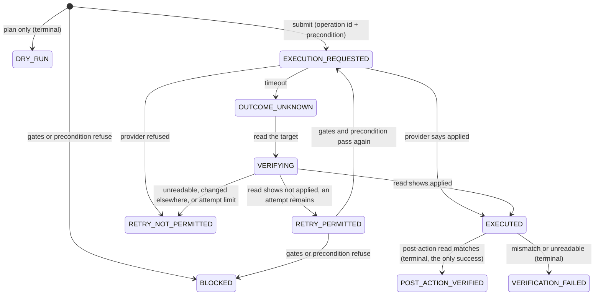

# Remediation execution semantics and the synthetic drill (OGWA-DEMO-03)

Remediation in OGWA is a controlled state transition, not a button click. The governed
path ([remediation.md](remediation.md)) still performs no change (D8, D153). This document
describes what *executing* a remediation means, and the **synthetic execution drill** that
demonstrates it against an in-memory provider fixture, with dry run, uncertain outcomes,
verification before retry, safe retry, and post-action verification.

Code: `app/domain/remediation_execution.py` (the state machine, pure),
`app/remediation/synthetic_provider.py` (the fixture and its fault scripts),
`app/remediation/drill.py` (a run, step by step, and the drill), `app/api/remediation.py`
(`RemediationService.drill`), `app/ui/static/js/drill.js` and `views/candidate.js` (the UI).
Invariants RX-1 to RX-10 in [../security/safety-invariants.md](../security/safety-invariants.md).

## What did not change

| Governed path | Status |
| --- | --- |
| `RemediationOutcome` (`SIMULATED`, `WHATIF`, `VALIDATION_ONLY`, `BLOCKED`) and `RemediationResult` (`executed` and `productionMutation` always false) | Unchanged |
| `ExecutionJob` (dry runs only, X-1, X-2), the execute route (refuses everyone), `EXECUTION_EXECUTE` (held by no role) | Unchanged (D153) |
| The remediation gates, the allowlist, the adapters (`DRY_RUN_MUTATION` policy), the AAP adapter, the PowerShell worker | Unchanged |
| `BUILD_ALLOWS_PRODUCTION_MUTATION = False`, the settings loader, the mutating-client split, `APPROVED_MUTATING_IMPORTERS` (empty) | Unchanged (D8) |
| The lifecycle state machine, approvals, the store schema, migrations, the audit chain | Unchanged; a drill writes nothing |

A drill is not a `RemediationOutcome` and creates no `ExecutionJob`. It changes only a
`SyntheticProviderFixture`: an in-memory copy of one candidate's synthetic evidence, built
when the drill starts and discarded when it answers. See [Owner review](#owner-review) for
how this reads against D153.

## The state machine



| State | Label (API and UI) | Meaning |
| --- | --- | --- |
| `DRY_RUN` | DRY RUN — NO STATE CHANGED | The change was computed against the provider's current state. Nothing was submitted. Terminal |
| `BLOCKED` | BLOCKED — NOT SUBMITTED | A gate, the allowlist, the environment, or the precondition refused this submission. Terminal |
| `EXECUTION_REQUESTED` | EXECUTION REQUESTED — SYNTHETIC DEMO | One attempt was submitted with the operation id and the precondition |
| `OUTCOME_UNKNOWN` | OUTCOME UNKNOWN — VERIFYING | The answer did not say whether the change was applied. Nothing is assumed or resubmitted |
| `VERIFYING` | VERIFYING — READING SYNTHETIC PROVIDER STATE | OGWA read the target (up to 2 reads) to find out |
| `RETRY_PERMITTED` | RETRY PERMITTED — VERIFIED NOT APPLIED | The read showed the before-state and an attempt remains. Permission, not an attempt |
| `RETRY_NOT_PERMITTED` | RETRY NOT PERMITTED — NEEDS A PERSON | Still unknown, changed outside the run, refused, or the attempt limit (2) reached. Terminal |
| `EXECUTED` | EXECUTED — SYNTHETIC DEMO | Applied, as the provider said or a read proved. Never final |
| `POST_ACTION_VERIFIED` | POST-ACTION VERIFIED | A post-action read found the target in its after-state and nothing else in scope changed. Terminal; the only success (the label was "VERIFIED" before OGWA-DEMO-04) |
| `VERIFICATION_FAILED` | VERIFICATION FAILED — NOT A SUCCESS | That read found something else, or could not be made. Terminal; never a success |

The table (`TRANSITIONS`) is closed; `check_transition` refuses anything else, and
`ExecutionTrace` refuses a recorded run that breaks an invariant (a retry not preceded by a
read showing the before-state, `EXECUTED` after a read that showed nothing applied, a third
submission, time going back, a run that stops at a non-terminal state, and, since OGWA-DEMO-04,
a `POST_ACTION_VERIFIED` step without the post-action predicate: reason
`MATCHES_EXPECTED_STATE`, the target observed in its after-state, at least one successful read,
and no other difference in scope).

**Before and after OGWA-DEMO-03.** Before, the only remediation states were the governed
outcomes (`SIMULATED`, `WHATIF`, `VALIDATION_ONLY`, `BLOCKED`): there was no notion of a
submitted change, an unknown outcome, a retry, or verification. After, those four are
unchanged, and the execution semantics above exist alongside them, driven only by the drill.

## Idempotency and the retry invariant

Nothing in the repository carried an operation id, an idempotency key, or a verification
predicate before (the worker's `correlationId` is a trace id, and `MutatingHttpClient` simply
never retries). The drill adds the smallest set that makes a retry provably safe:

1. **An operation id per approved change** (`operation_id`): `rop_` and 32 hex digits of a
   digest of the candidate, operation, target identity digest, approval, and evidence
   fingerprint. Every attempt of that change, in any run, carries the same id.
2. **A precondition** (`PlannedTransition.before`): the target's planned before-state. The
   provider refuses a submission whose target is not in it (compare-and-set).
3. **Provider-side idempotency**: the fixture refuses an id it has already applied
   (`DUPLICATE_OPERATION`), without a change.
4. **Verification before retry**: after an unknown outcome, only a read that shows the
   before-state permits a retry (`retry_decision`). An unreadable target never does.
5. **Gates again before the retry**: the retry is submitted only if the governed gates pass at
   the retry's own time (`ExecutionRun.request` calls `recheck`), and the precondition is read
   again just before it.
6. **A bound**: at most 2 submissions (`MAX_SUBMISSIONS`, a source constant).

> **Invariant.** A change is submitted again only after a read proved the earlier
> submission was not applied, the gates passed again, and the precondition still held.
> An uncertain outcome never causes a second application of the same change.

Layers 3 and 4 are independent: the engine never sends a duplicate (it verifies first), and
the fixture would refuse one anyway (`test_an_applied_operation_id_is_never_applied_twice`).

## The synthetic provider fixture and fault injection

`SyntheticProviderFixture.from_evidence` copies the candidate's scope from its recorded
`SYNTHETIC` evidence (it refuses any other source): each assignment of the Okta group
(`okta-assignment:<id>` → `present`) and the mapped AD group (`ad-group:<objectGUID>` →
`exists`, `distinguishedName`, `sid`, `samAccountName`). It holds no store, client, or
connection.

Every change goes through `MutationCapableService._perform` with the policy injected (P01):
`LOCAL_SYNTHETIC` (EXECUTE for a synthetic target) for a synthetic execution,
`DRY_RUN_MUTATION` (plan only, so nothing can apply) for a dry run. Any other policy is
refused at construction.

**Fault injection is a closed, deterministic catalog** (`SCENARIOS`); a request names a key
and cannot describe faults. Each script says what each submission does and which reads fail:

| Scenario | Script | Ends in |
| --- | --- | --- |
| `NO_FAULT` | applied, acknowledged | `POST_ACTION_VERIFIED` (1 submission) |
| `TIMEOUT_NOT_APPLIED` | 1st: timeout before applying; 2nd: applied | `POST_ACTION_VERIFIED` (2 submissions, 1 change) |
| `TIMEOUT_AFTER_APPLY` | 1st: applied, answer lost (timeout) | `POST_ACTION_VERIFIED` (1 submission; no resubmission) |
| `TIMEOUT_UNVERIFIABLE` | 1st: timeout; reads 2 and 3 fail | `RETRY_NOT_PERMITTED` (`OUTCOME_STILL_UNKNOWN`) |
| `REPEATED_TIMEOUT` | both: timeout before applying | `RETRY_NOT_PERMITTED` (`ATTEMPT_LIMIT_REACHED`) |
| `ACKNOWLEDGED_NOT_APPLIED` | acknowledged, nothing applied | `VERIFICATION_FAILED` |

There is no randomness and no wall clock: a synthetic clock advances 2 s per acknowledged
submission, 30 s per timeout, 1 s per read, and 10 s per failed read. The fixture's ledger
records what really happened inside it; the drill never reads it to decide anything, and
reports it so a reviewer (and the tests) can check OGWA's reads against the truth.

The tests also build scripts the catalog does not expose: a change made by a person outside
the run (observed, not duplicated), a target moved elsewhere (`TARGET_CHANGED_OUTSIDE_RUN`), a
collateral change elsewhere in scope (`UNEXPECTED_CHANGE_IN_SCOPE`), and a failed post-action
read (`POST_ACTION_UNREADABLE`).

## The drill

`POST /api/v1/candidates/{candidateId}/remediation-drills` (permission
`EXECUTION_PLAN_DRY_RUN`):

```json
{"operation": "OKTA_GROUP_UNASSIGN", "target": {"assignmentId": "asgn_…"}, "approvalId": "apr_…",
 "expectedEvidenceFingerprint": "sha256:…", "mode": "SYNTHETIC_EXECUTION", "scenario": "TIMEOUT_NOT_APPLIED"}
```

1. `executionMode: PRODUCTION_MUTATION` or `dryRun: false` → 403 `PRODUCTION_MUTATION_REFUSED`,
   before anything else is read. Any other unknown field (`executionMode`, `dryRun`, `faults`,
   `adapter`, …) → 422. `mode` is `DRY_RUN` or `SYNTHETIC_EXECUTION`; an execution names one
   catalog scenario and a dry run names none (422 otherwise).
2. The permission, the candidate, a fresh view (`409 EVIDENCE_CHANGED`), the approval, and
   separation of duties (`403 SEPARATION_OF_DUTIES`, D49), exactly as for a dry run.
3. Drills run only in `LOCAL_SYNTHETIC`, over a `SYNTHETIC` store, with the `SYNTHETIC` adapter
   (409 `SYNTHETIC_DRILL_UNAVAILABLE` otherwise).
4. The governed `remediation_dry_run`: every gate, the allowlist, the adapter. A blocked request
   is 409 `REMEDIATION_BLOCKED` with every gate, and **no fixture is built** (D133).
5. The fixture, then the dry run or the run. The answer (200) carries the governed plan and
   gates, the operation id, the planned transition, every step with its label, the fixture's
   state and digest before and after, its ledger, and `syntheticOnly: true`,
   `productionMutation: false`, `externalSystemsContacted: false`, `recorded: false`,
   `lifecycleChanged: false`.

A drill records nothing: no audit event, job, decision, or evidence. It changes no governed
state, so it is not a governed route and its refusals stay in the security log (D64, D72), like a
mapping inspection. `GET /api/v1/remediation-drill-scenarios` (`READ_INVENTORY`) lists the
catalog, the modes, and every state's label.

**In Demo Mode** the route is `SIMULATED` and `NON_PERSISTING`, so the read-only hosted demo
serves it too ([../demo-mode.md](../demo-mode.md)).

## The demo walkthrough

Null Meridian's evidence was collected a week before its snapshot, so before this work no
candidate could pass the remediation gates' 24-hour EXECUTION window at the demo's clock.
**NM-C11** (`OKTA-AdAnalytics-Users`, portfolio scenario 10) is approved for the Okta
unassignment on evidence collected again on the snapshot day
([../demo/null-meridian.md](../demo/null-meridian.md)). As `synthetic.executor.one`, open
NM-C11 and, under **Remediation: dry run or synthetic drill**:

1. **Dry run** → DRY RUN — NO STATE CHANGED; 0 submissions; the same digest before and after.
2. **Synthetic execution drill**, *Timeout, change not applied* → EXECUTION REQUESTED (+0 s),
   OUTCOME UNKNOWN — VERIFYING (+30 s), VERIFYING (not applied), RETRY PERMITTED, EXECUTION
   REQUESTED (same operation id), EXECUTED — SYNTHETIC DEMO, POST-ACTION VERIFIED; the ledger
   shows one applied change. The result opens with the SYNTHETIC EXECUTION banner ("No external
   provider or persistent environment was modified.") and lists, under **Authorized by**, the
   policy version, the decision and approval with their audit sequences, and the operation id.
3. *Timeout, change already applied* → verified applied, never resubmitted.
4. *Acknowledged, but not applied* → VERIFICATION FAILED — NOT A SUCCESS.
5. Reload: the candidate is still `APPROVED`, with no dry-run job and no new audit event.

NM-C10 (conflicting evidence) has no approval, so no drill or retry can ever start from it.

## Policy binding and the authorization chain (OGWA-DEMO-04)

OGWA-DEMO-02 records, with every approval and lifecycle decision, the exact policy that judged it
(PV-4); this lane re-evaluates the governed gates under the policy in force. OGWA-DEMO-04 joins
them in `app/api/authorization.py`, from recorded data only:

- **The chain.** For the approval a request cites: its `APPROVAL_RECORDED` event and the policy
  reference that event recorded; the lifecycle decision that applied it (the transition whose
  `approval_id` it is) with its `TRANSITION_APPLIED` event and recorded reference; and the policy
  in force now. Each recorded reference is read back as recorded (PV-6), never filled in.
- **The binding rule (fail closed).** While a policy version is recorded, a remediation dry run
  or drill may rest only on an approval, and a decision applying it, judged by that same version
  (`IN_FORCE`: same id, sequence, and digest). `SUPERSEDED` or `NOT_RECORDED` is refused with
  `409 APPROVAL_POLICY_NOT_IN_FORCE` after the governed gates pass and **before any fixture
  exists**; a drill asks again before a retry (a version recorded meanwhile blocks the retry, as a
  gate would). The classic world has no recorded version (`UNRECORDED_POLICY`) and is unchanged.
  This enforces what `operation_id` assumed: a new policy version needs a new approval, so a new
  operation id.
- **Recorded dry runs.** `REMEDIATION_DRY_RUN_RECORDED` events now record the policy reference
  their gates were judged by, checked inside the write exactly like a decision's
  (`Store._check_policy_ref`), and `GET …/remediation-dry-runs` shows it as recorded with a
  `chain`: policy, decision, approval, and the operation id of the approved change (the same id a
  drill of it carries).
- **Drill responses** carry `authorization` (the chain with each link's audit event id, sequence,
  digest, recorded policy, and binding) and `chain`: policy id, version, version id, sequence,
  digests; decision and approval ids with their audit sequences; operation id; execution mode and
  scenario; each attempt (provider answer, verification read, the state that followed); the
  post-action result (`CONFIRMED` / `FAILED` / `NOT_REACHED`); final state and label; and
  `recorded: false`. Every drill also carries the server-worded `modeBanner`: DRY RUN — NO STATE
  CHANGED, or SYNTHETIC EXECUTION, "No external provider or persistent environment was modified."

The generated reviewer sample, [../demo/samples/ogwa-audit-sample.json](../demo/samples/ogwa-audit-sample.json)
(`python -m app.demo.null_meridian.audit_sample --write`), shows the whole chain for NM-C10 and
NM-C11 as the API serializes it.

## Owner review

D153 says "Every job is a dry run, and no remediation outcome is an execution." This work
reads that as a rule about the governed path, which it leaves exactly as it was, and uses the
execution branch P01 designed for synthetic targets (`MutationPolicy`: `LOCAL_SYNTHETIC` and
a synthetic target → EXECUTE) only on a discarded in-memory fixture. An owner should confirm
that reading. If it is not accepted, removing the drill route, its demo classification, and the
UI section removes every synthetic execution without touching the governed path.

**OGWA-DEMO-04 adopts that reading for the portfolio demo, as its brief directs.** D153 itself
reads "No *production* deletion, quarantine, or restoration execution path may be enabled", and
nothing here enables one: the governed remediation path stays non-executing (every outcome a
plan, the execute route refusing everyone, `BUILD_ALLOWS_PRODUCTION_MUTATION` `False`,
`APPROVED_MUTATING_IMPORTERS` empty), and the drill mutates only its discarded in-memory fixture,
which is neither a provider nor a persistent environment. The UI and every response say so
("SYNTHETIC EXECUTION — No external provider or persistent environment was modified."). No owner
decision in `decisions.md` contradicts it; none was added or changed.

## Shared contract notes

- **OGWA-DEMO-02 (versioned policy, `origin/claude/great-cray-aekjes`, `674644f`).** A drill
  re-evaluates the policy in force at each submission through `remediation_dry_run` and
  `policy_in_force`. `operation_id` does not include a policy version: the approval id is in
  it, and DEMO-02 binds each approval to the version that judged it, so a different version
  already means a different approval and a different id (enforced since OGWA-DEMO-04 by the
  binding rule above). A trial merge of the two lanes was
  run (not pushed). It needs, and passes 328 tests of both lanes and the shared goldens with:
  (1) in `seed_null_meridian`, `world.snapshot_day()` and `world.record_results()` after the
  later policy releases are recorded (this is why the seed is split into triage and snapshot
  day), so NM-C11's approval is judged by, and records, v1.2.0; (2) in `views/candidate.js`,
  both sections, `explanationSection` then `drillSection`; (3) the combined fresh head
  `sha256:e8793f89dbff9c124d9c3b00fe0ea81d2ab5f07c1dc9bb05c8fce128d682eb41` (sequence 1457) in
  `tests/test_null_meridian_seed.py`, `scripts/hosted_smoke.py`, and the docs; (4) DEMO-02's
  `test_every_seeded_decision_records_the_version_that_judged_it` expecting v1.2.0 for
  NM-C11's approval; (5) both sides of each documentation conflict.
- **OGWA-DEMO-04.** The drill is the integration point for any later remediation lane: a
  real executor must keep the same state machine, operation id, precondition, verification
  before retry, and post-action verification, must keep the policy binding, and must not reuse a
  drill's result as evidence. The integrated seed re-derived the recipe above rather than copying
  it: the release order is the same, and a two-sided chronology check
  (`policy_chronology_problems`) now stops the seed unless every decision and approval records
  the release in force on its own date. The combined head is that value (1,458 events); a later
  dataset change must update the same goldens and regenerate the audit sample.

## Tests

| File | Covers |
| --- | --- |
| `tests/test_remediation_execution.py` | The table (closed, exhaustive), labels, the retry decision, trace invariants, the fixture (idempotency, precondition, plan-only policy, faults, determinism), a run step by step, the `MutationCapableService` inventory |
| `tests/test_remediation_drill_api.py` | Every scenario for all three operations through the API; dry run changes nothing; timeouts verified, retried once, never duplicated; verification failure never a success; gates re-evaluated before a retry on real evidence; a drill writes nothing (`table_dump`) and contacts nothing; every refusal; NM-C11 drillable and no other Null Meridian candidate |
| `tests/test_ui_drill.py`, `tests/ui/drill.test.mjs` | The UI wording against real API output |
| `tests/browser/test_remediation_drill_ui.py` | The walkthrough in headless Chrome, by keyboard, at desktop and 375 px |
| `tests/test_cloudflare_hosted.py` | The drill on the read-only hosted demo records nothing |
| `tests/test_ogwa_demo_integration.py` | OGWA-DEMO-04: the chain names the exact policy, decision, and approval; history keeps its version; a superseded approval authorizes nothing (start, retry, store write); seed chronology; NM-C11 freshness; NM-C10 unreachable; the post-action predicate; the audit sample is the API's own output and sanitized; dry run vs synthetic execution wording |
